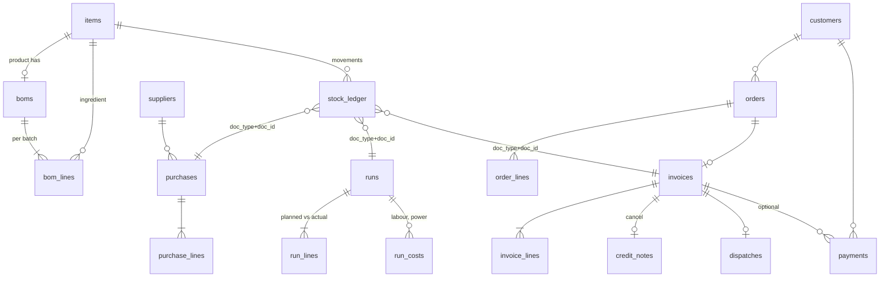

# Design note

## 1. Data model

`items` holds raw, packaging and finished goods (`kind`), each with a `base_unit` (g / ml / pc), a display unit and factor
(`kg`=1000 g, `l`=1000 ml, `carton`=`carton_size` pc). `stock_ledger(item, qty, value, doc_type, doc_id, user, ts)` is the only place
stock lives. `audit_log` is separate and append-only.

## 2. How stock and BOM consumption work

* **Balance = SUM(qty)** over the ledger per item. Opening stock is itself a ledger row (`doc_type='opening'`), so
  opening + receipts − issues ± adjustments = closing holds by construction, and the stock summary report computes those columns from date ranges.
* **Units:** every input is converted once, in `to_base()`, to an integer base unit; fractions of a base unit are rejected; a kg item
  refuses litres. Nothing is stored as a float.
* **BOM:** `bom_lines.qty_base` per batch, `basis='batch'` or `'packet'` (pouches: one per packet). `boms.yield_packets` is expected output per batch.
* **Production run:** `start_run` snapshots *planned* quantities (BOM × batches) into `run_lines` and posts the raw issues the supervisor actually
  entered (`production_issue`). `complete_run` posts packaging (pouches = good + damaged; cartons as entered), then posts finished goods (`production_output`)
  valued at the run's total material cost. All of it is one DB transaction.
* **Variance:** `(actual − planned) / planned × 100` per line and for yield (expected vs good packets); flagged if `|variance| > tolerance`.
* **Sales:** admin stock check uses `FG balance − quantity reserved by other approved/invoiced orders`. Dispatch posts the finished-goods issue
  (`doc_type='invoice'`) at weighted-average cost and records COGS on the invoice line. Cancelling posts a return at that same cost.

## 3. Costing and valuation

* **Method: moving weighted average**, recomputed at each issue as `ledger value ÷ ledger qty`. Chosen over FIFO because small-factory
  purchase prices fluctuate and WAC gives one stable cost without layer tracking; over "last price" because it does not distort old stock.
* **Overheads:** labour, gas/power and other costs are recorded against a run and allocated 100% to that run's good packets
  (single-product runs make this exact). For shared monthly overheads the natural rule is allocation by packets or by batch-hours; not built.
* **Cost per packet** = (material cost + run overheads) ÷ good packets. Bad output is therefore costed into good output, which is what makes
  wastage visible in the margin. Margin = selling price − cost per packet.

## 4. GST and audit
* Invoice tax is computed per line in integer paise, rounded half-up; intra-state (seller state code = place of supply) splits CGST/SGST equally,
  otherwise IGST. Invoice numbers are `INV/<FY>/<seq>` with a per-financial-year counter (April–March).
* Posted invoices cannot be deleted (trigger). Cancellation creates a credit note `CN/<FY>/<seq>`, returns stock and is reported as a negative in the GST summary.
* Every state change writes `audit_log(ts, user, action, entity, id, detail)`; order edits store before/after line items.

## 5. Offline orders
The order page caches the price list in `localStorage`; submitted orders go to an outbox with a client-generated UUID and are POSTed
when online. `orders.client_uuid` is UNIQUE and `create_order` is idempotent on it, so a retry after a timed-out success never duplicates.
